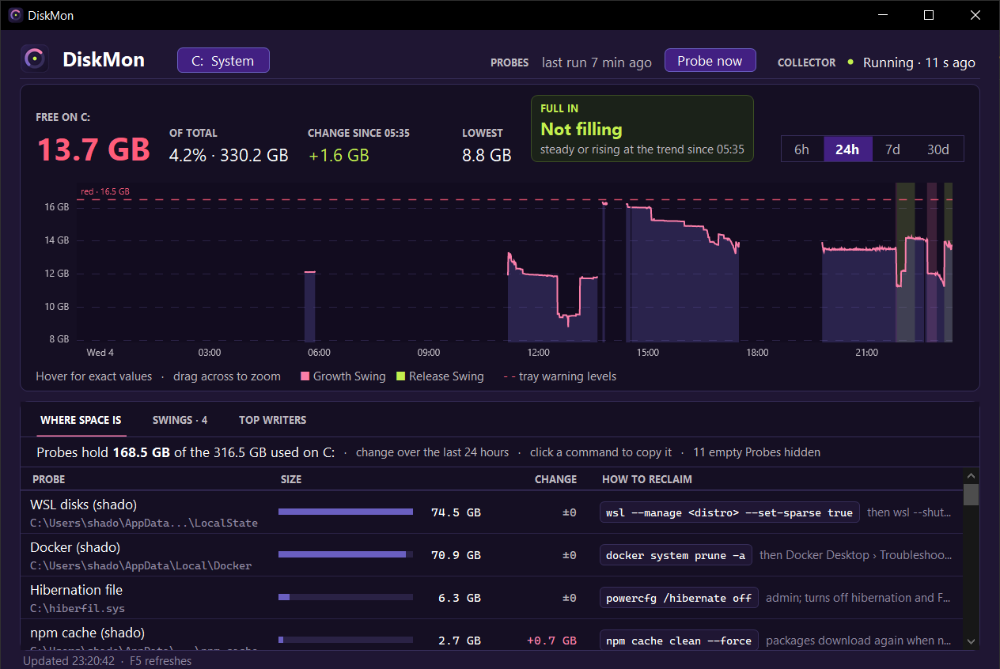
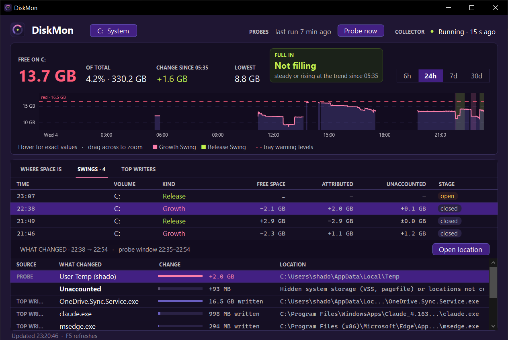

<p align="center">
  
</p>

<h1 align="center">DiskMon</h1>

<p align="center">
  <b>Find out where your free space went.</b><br>
  A Windows disk-space monitor that records <i>when</i> free space changes, <i>what</i> grew or shrank, and <i>which program</i> was writing.
</p>

<p align="center">
  
</p>

## Why

Windows drives tend to fill up quietly and then, just as suddenly, free 5 to 10 GB again. Updates download and clean
up, shadow copies come and go, WSL and Docker disks grow, browsers and package managers cache everything. A one-off
treemap shows what is big *now*; it can't tell you what changed last night.

DiskMon runs in the background and keeps a timeline. When free space moves by 1 GB or more within 15 minutes it records
a **Swing** and explains it: which known locations changed across it, which programs wrote the most while it happened,
and how much is still **Unaccounted**.

## Features

- **Free-space timeline** for C: (other fixed drives are opt-in), sampled every 30 seconds and kept for 30 days.
- **Tray icon** showing free space in GB, coloured green, amber or red as the drive fills, and grey when the
  Collector isn't running.
- **Dashboard** with a zoomable free-space chart, warning lines, the lowest point, the change over the range, and a
  "days until full" forecast. Ranges from 6 hours to 30 days.
- **Swings**: every growth or release of 1 GB or more, including ones across a reboot or sleep, with the Probes that
  changed, the Top Writers at the time, and the Unaccounted remainder.
- **Probes**: the usual suspects measured every 10 minutes and at each Swing: Windows Update, temp folders, crash
  dumps, page/hibernation/swap files, VSS shadow storage, the Recycle Bin, browser profiles, Docker and WSL disks,
  npm/pnpm/Yarn/pip/NuGet/Gradle/Maven caches and more. "Probe now" measures them on demand.
- **Top Writers**: the programs that wrote the most, per minute, summed across their copies.
- **Open location**: jump from a Probe or Swing item straight to the folder in Explorer.
- **Small footprint**: capped logs (7 × 10 MB), automatic retention, and no growth problem of its own.

DiskMon only watches and explains. It never deletes anything.

<p align="center">
  
</p>

## How it works

DiskMon is two processes sharing one SQLite database at `%ProgramData%\DiskMon\diskmon.db`:

| Part | Runs as | Does |
|---|---|---|
| **Collector** (`DiskMon.Collector`) | Windows Service, LocalSystem | The only writer. Samples free space, process I/O, Probes and VSS; detects and attributes Swings; serves the `DiskMon` named pipe. |
| **Tray** (`DiskMon.Tray`) | Your user, unprivileged | Reads the database read-only; shows the tray icon and dashboard; asks the Collector for "Probe now" over the pipe. |

The data folder is writable only by SYSTEM and Administrators, so a normal user can read the history but not rewrite
it. Design notes live in [PLAN.md](PLAN.md), the vocabulary in [GLOSSARY.md](GLOSSARY.md) and the decisions in
[docs/adr](docs/adr/).

## Install

Requirements: Windows 10 1809 or later (x64), the [.NET 10 SDK](https://dotnet.microsoft.com/download/dotnet/10.0)
to build, and an administrator PowerShell.

```powershell
git clone https://github.com/AnwarRezk/disk-monitor.git
cd disk-monitor
.\scripts\install-service.ps1
```

The script publishes self-contained builds and:

1. installs the Collector to `%ProgramFiles%\DiskMon\Collector` and registers the `DiskMon` service (automatic start);
2. installs the Tray to `%ProgramFiles%\DiskMon\Tray` and starts it at every user's logon;
3. starts the service, which creates `%ProgramData%\DiskMon` with its locked-down ACL on first run.

Run it again to upgrade in place; your `appsettings.json` is kept unless you pass `-ResetConfig`.

To remove DiskMon (add `-RemoveData` to also delete the history and logs):

```powershell
.\scripts\uninstall-service.ps1
```

Check the service with `sc.exe query DiskMon` (in PowerShell, write `sc.exe`: plain `sc` is `Set-Content`).

## Use

- **Hover** the tray icon for free space and the change over the last 24 hours.
- **Double-click** it, or right-click → *Open dashboard*.
- In the dashboard, drag across the chart to zoom (Esc resets), switch ranges at the top of the chart, and use the
  tabs: **Where space is** (Probe sizes), **Swings** (pick one for its detail) and **Top Writers**.
- Right-click the tray icon for *Probe now* and *Open data folder*.

## Configure

Settings live in `%ProgramFiles%\DiskMon\Collector\appsettings.json`: volumes, sampling intervals, the Swing threshold,
retention, the tray colour thresholds and the Probe list. Per-user Probes use a `{user}` template that expands to every
profile under `C:\Users`. Restart the service after editing:

```powershell
sc.exe stop DiskMon; sc.exe start DiskMon
```

## Develop

```powershell
dotnet build                                   # whole solution; also builds on Linux/macOS
dotnet test                                    # xUnit tests
dotnet run --project src/DiskMon.Collector     # Collector as a console app (elevated terminal)
dotnet run --project src/DiskMon.Tray          # Tray (normal terminal)
.\scripts\simulate-growth.ps1 -SizeGB 2 -Location temp -Cleanup   # make a test Swing (admin)
```

`DiskMon.Tray.exe --screenshot <folder>` saves the dashboard at every range and size, which is handy when reviewing UI
changes. Contributor notes are in [CLAUDE.md](CLAUDE.md).

## Privacy

The Collector measures every user profile's Probes, and the database is readable by all local users. That's fine on a
personal machine; keep it in mind on a shared one.

## License

[MIT](LICENSE) © 2026 Anwar Rezk
